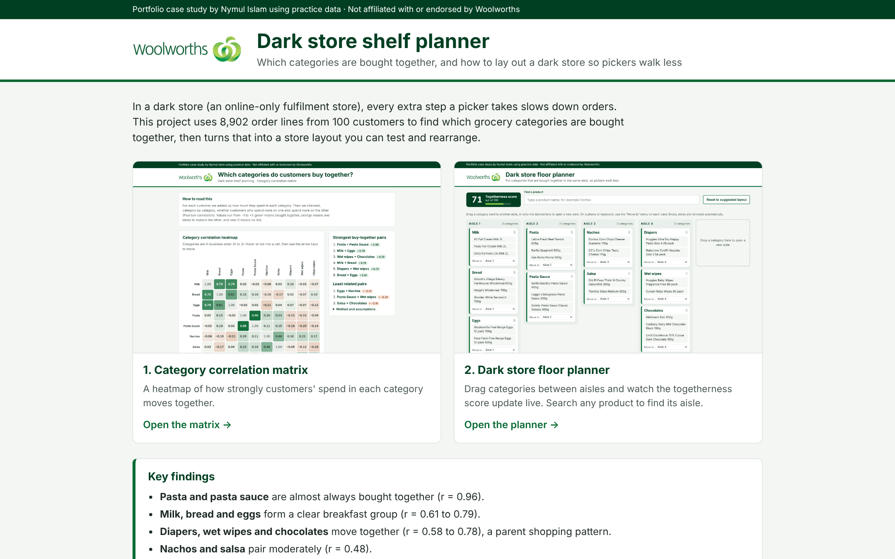
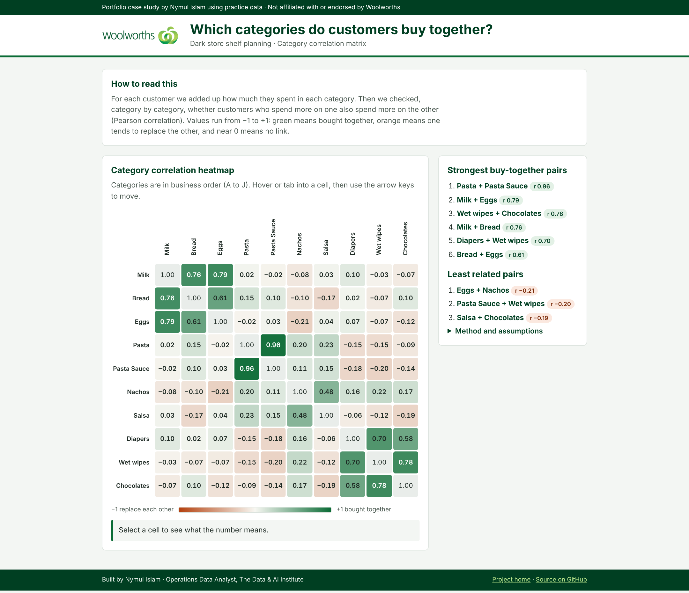
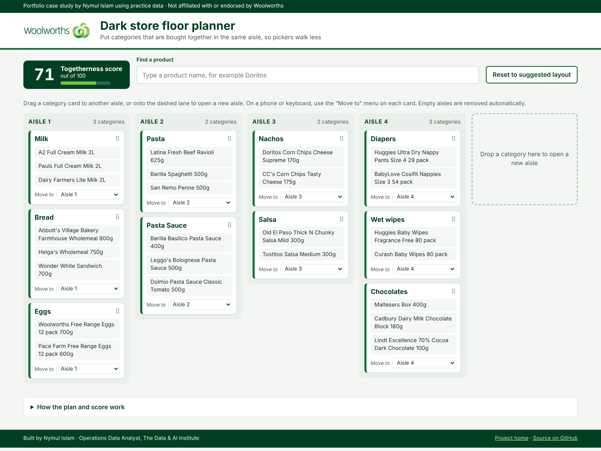

# Woolworths Dark Store Shelf Planner

Which grocery categories do customers buy together, and how should a dark store be laid out so pickers walk less? This project answers both with two interactive, single-file HTML tools.

**🔗 Live project: https://nymul-seam.github.io/woolworths-dark-store-planner/**

- [Category correlation matrix](https://nymul-seam.github.io/woolworths-dark-store-planner/correlation-matrix.html)
- [Dark store floor planner](https://nymul-seam.github.io/woolworths-dark-store-planner/floor-planner.html)

[](https://nymul-seam.github.io/woolworths-dark-store-planner/)

> Portfolio case study using practice data. It is not affiliated with or endorsed by Woolworths.

---

## Business problem

A dark store is an online-only fulfilment store. Every extra step a picker takes slows down orders, so products that are bought together should sit close together. The brief was to:

1. Measure how strongly each pair of product categories is bought together.
2. Turn that into a starting aisle layout that a planner can rearrange and score.

## Key findings

| Category group | Correlation (r) |
|---|---|
| Pasta + Pasta Sauce | 0.96 |
| Milk + Eggs / Milk + Bread / Bread + Eggs | 0.79 / 0.76 / 0.61 |
| Wet wipes + Chocolates / Diapers + Wet wipes / Diapers + Chocolates | 0.78 / 0.70 / 0.58 |
| Nachos + Salsa | 0.48 |

The suggested four-aisle layout scores **71 / 100** for togetherness:

1. Milk, Bread and Eggs
2. Pasta and Pasta Sauce
3. Nachos and Salsa
4. Diapers, Wet wipes and Chocolates

## Deliverable 1: Category correlation matrix

[](https://nymul-seam.github.io/woolworths-dark-store-planner/correlation-matrix.html)

- A 10 × 10 heatmap in business order (A. Milk to J. Chocolates), not alphabetical order.
- A diverging colour scale: green means bought together, orange means one replaces the other, pale means no link. The value is printed in every cell.
- Hover or tab into a cell, then use the arrow keys, to read what each value means.
- Lists of the strongest and least related pairs.

## Deliverable 2: Dark store floor planner

[](https://nymul-seam.github.io/woolworths-dark-store-planner/floor-planner.html)

- Each category is a card with all its products stacked inside, highest spend first.
- The starting aisles come from clustering the correlation matrix.
- Drag a card to another aisle, or onto the dashed lane to open a new aisle. Empty aisles disappear.
- On a phone or with a keyboard, use the **Move to** menu on each card.
- A single **togetherness score** (0 to 100) updates on every move.
- **Product search** highlights the product and names the aisle it sits in.

## Method

- **Spend** = quantity × unit price, summed per customer for each category: 100 customers and 8,902 order lines.
- **Correlation:** the Pearson correlation between every pair of categories, across all customers. A customer with no spend in a category counts as $0.
- **Starting aisles:** average-linkage agglomerative clustering on the correlation matrix. The two groups with the highest average correlation are merged, again and again, until no pair of groups averages at least 0.40.
- **Togetherness score:** the average correlation of every pair of categories that share an aisle, × 100, kept between 0 and 100. A category alone in its aisle adds no pairs. If no aisle has two categories, the score is 0.

## Assumptions

- 496 lines repeat exactly within the same order. They are kept as real purchases, because nothing in the data marks them as errors.
- Business order follows the letter prefix in the category names (A to J). The prefix is hidden in labels.
- Customer names are not used. They are removed from the published data file.
- Because the score is an average, moving a weakly linked category into its own aisle can raise it slightly. For example, taking Chocolates out of the baby aisle moves the score from 71 to 72. That is how the formula in the brief behaves.

## Tools

HTML, CSS and vanilla JavaScript (no libraries or frameworks) · Python and pandas (data check) · AI-assisted development with Claude · GitHub Pages (hosting)

Each HTML file is self-contained: the data, the logo and all the code are built in, with no external calls. Each one works on GitHub Pages or when opened straight from your computer. The pages work on phones, can be used with a keyboard, and meet WCAG AA colour contrast.

## Repository structure

```
woolworths-dark-store-planner/
├── index.html                  # project home page linking both tools
├── correlation-matrix.html     # Deliverable 1
├── floor-planner.html          # Deliverable 2
├── README.md                   # this file
├── screenshot.png              # home page preview
├── screenshot-matrix.png       # matrix preview
├── screenshot-planner.png      # planner preview
└── woolworths_order_lines.csv  # order lines with spend, customer names removed
```

## Author

**Nymul Islam**, Operations Data Analyst, The Data & AI Institute · Hobart, Tasmania

- LinkedIn: https://www.linkedin.com/in/md-nymul-islam
- GitHub: https://github.com/nymul-seam
